<div align="center">


<br>

**A phone-first trade-trust system for the Kashgar &rarr; Khunjerab &rarr; Sost corridor.**<br>
Read the receipt. Seal the shipment. Prove nothing changed.

<br>

[](backend/tests)
[](frontend/src)
[](#-three-languages-two-directions)
[](#-how-the-proof-works)
[](#-honest-limits)

[**Watch the demo**](#-demo-video) &nbsp;·&nbsp; [**See it**](#-see-it) &nbsp;·&nbsp; [**Break it**](#-try-to-break-it) &nbsp;·&nbsp; [**Run it**](#-run-it-in-two-minutes) &nbsp;·&nbsp; [**How it works**](#-how-the-proof-works)

</div>

<br>

> **Working name.** The project will be renamed. Nothing in the code depends on the name.

---

## The problem in one paragraph

A trader in Gilgit buys phone accessories in Kashgar. The only record is a paper receipt in Mandarin. It is carried over
the Khunjerab Pass, and at the Sost dry port a customs officer has to decide, with no common language and no way to check
the paper, whether the goods, the price and the journey are what they claim. The route is now open all year. **Trust in
what crosses it has not kept up.**

<table>
<tr>
<td width="33%" valign="top">

### Rs 14.93 bn
Customs collected on Khunjerab imports in FY2025&ndash;26, up from Rs 13.67 bn the year before.<br>
<sub>Dawn, 2026 &mdash; <a href="https://www.dawn.com/news/1953421">source</a></sub>

</td>
<td width="33%" valign="top">

### ~240 consignments
Traders said they were stuck at Sost for seven months in 2025, and trade halted during the sit-in.<br>
<sub>Dawn, Jul 2025 &mdash; <a href="https://www.dawn.com/news/1925708/traders-block-sost-port-over-khunjerab-trade-halt">source</a></sub>

</td>
<td width="33%" valign="top">

### QR seals are coming
FBR has begun designing a national cargo-tracking system with a QR digital seal per consignment.<br>
<sub>Dawn, 2026 &mdash; <a href="https://www.dawn.com/news/1978938/pakistan-moves-to-digital-cargo-tracking">source</a></sub>

</td>
</tr>
</table>

<sub>Every figure here, and the rest of the research, is listed with its source and a confidence grade in
[`docs/research/FACTS.md`](docs/research/FACTS.md).</sub>

---

## The journey of one shipment


| | Who | What happens | What is proven |
|---|---|---|---|
| **1 Scan** | Trader | Photo of the Chinese receipt is read, translated to Urdu and English, and matched to HS codes. Prices outside the usual band are flagged. | Every line is editable, and every edit is audited. |
| **2 Pay** | Trader + seller | Sandbox yuan moves after a PIN. The seller opens a Mandarin link and counter-signs the goods and amount with a key kept on their phone. | Two independent signatures agree on the same list. |
| **3 Seal** | Trader | The exact manifest hash is signed on the phone. A QR carries the seal. | Changing any line afterwards breaks the seal. |
| **4 Track** | Trader / driver | Each checkpoint signs the phone's real GPS fix. With no signal it is queued on the device and sent later. | A hash chain proves order and a geofence check flags off-route points. |
| **5 Clear** | Customs | One integrity banner. Every signature is re-verified **in the officer's own browser**. A signed decision clears or holds. | The officer does not have to trust the server. |

---

## 📸 See it

### On the trader's phone

<table>
<tr>
<td align="center" width="25%">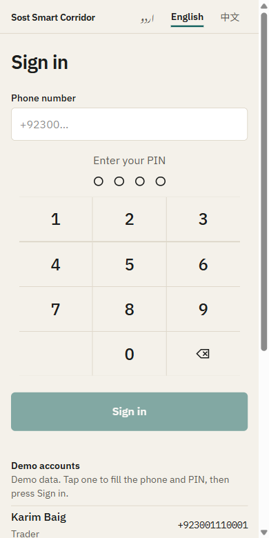<br><sub><b>Sign in</b><br>PIN pad, labelled demo accounts</sub></td>
<td align="center" width="25%">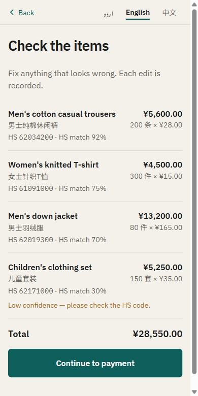<br><sub><b>Check the items</b><br>HS codes, confidence, price flags</sub></td>
<td align="center" width="25%">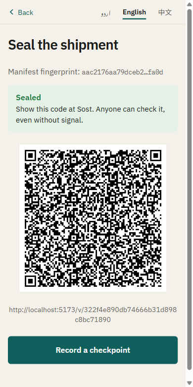<br><sub><b>Sealed</b><br>QR verifiable offline</sub></td>
<td align="center" width="25%">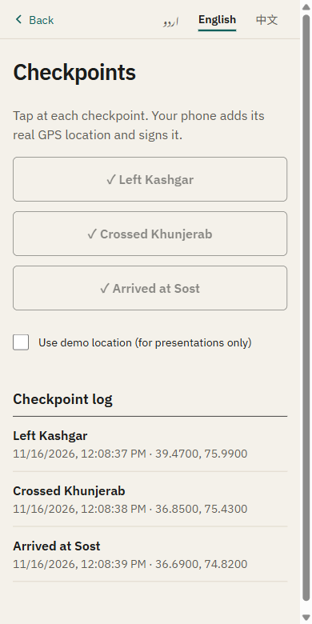<br><sub><b>Checkpoints</b><br>Signed GPS, offline queue</sub></td>
</tr>
</table>

### Three languages, two directions

<table>
<tr>
<td align="center" width="25%">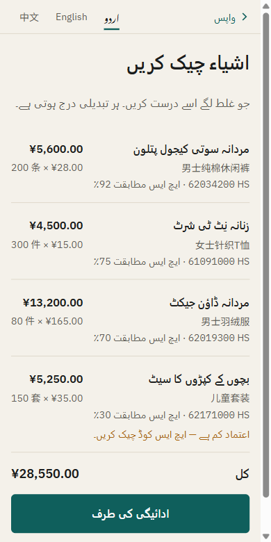<br><sub><b>اردو</b><br>Fully right-to-left</sub></td>
<td align="center" width="25%">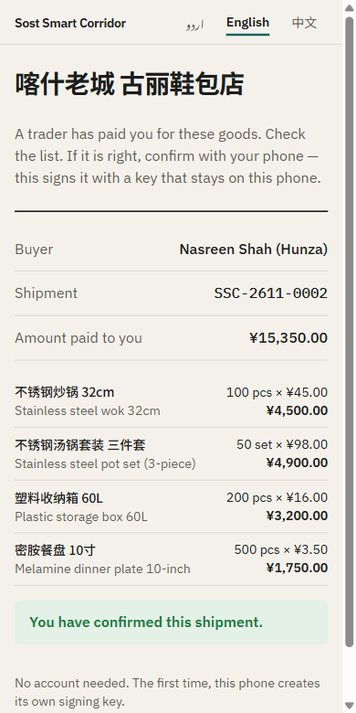<br><sub><b>中文</b><br>The seller's page opens in Mandarin</sub></td>
<td align="center" width="25%">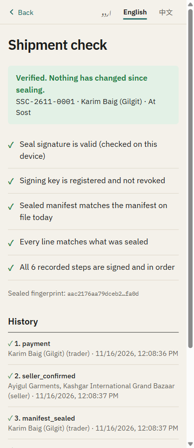<br><sub><b>Anyone can verify</b><br>No login, scan the QR</sub></td>
<td align="center" width="25%">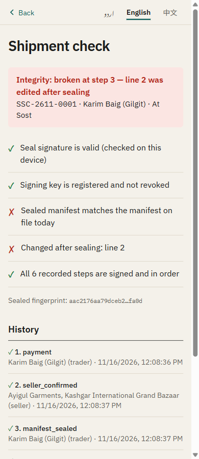<br><sub><b>…and anyone can see a break</b><br>Exact line, exact step</sub></td>
</tr>
</table>

### At the customs desk

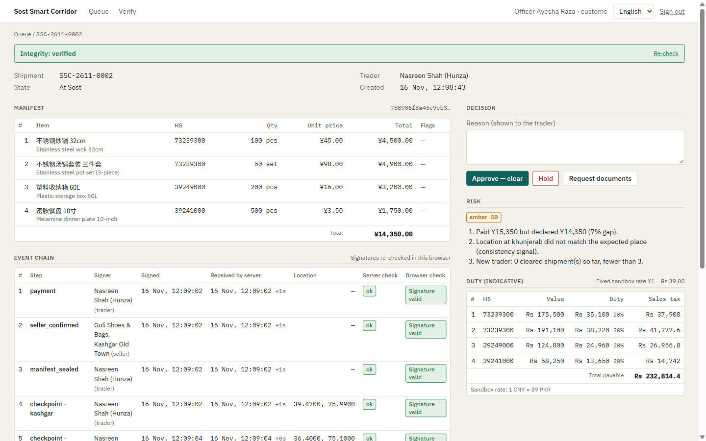

<sub>One banner, the manifest, the signed chain with each signature re-checked in the browser, the receipt image,
the risk reasons in plain sentences, and an indicative duty estimate.</sub>

<details>
<summary><b>More screens</b> (queue, admin tamper lab)</summary>
<br>

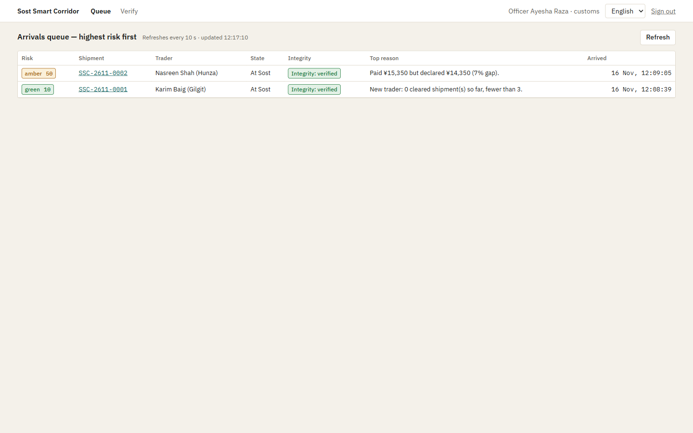
<br><br>
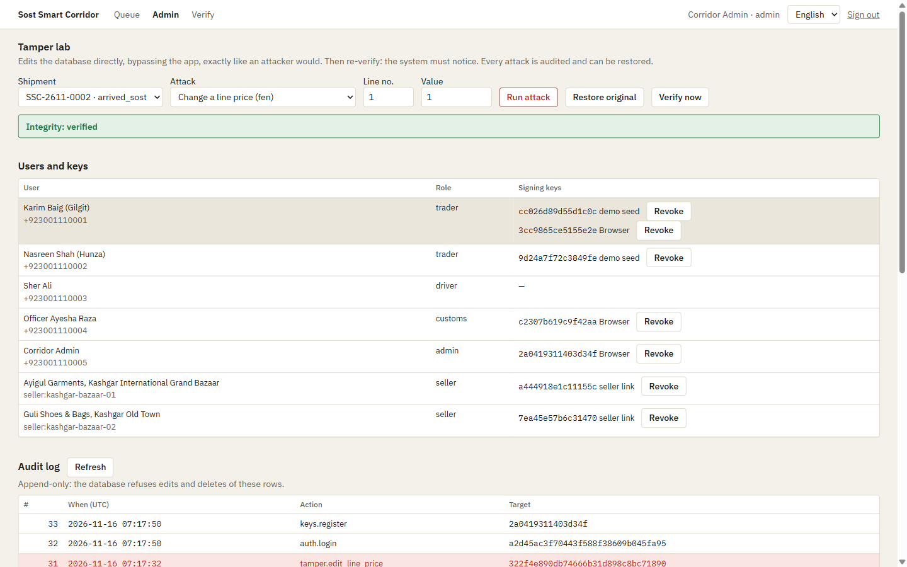

</details>

---

## 🎬 Demo video

<!--
  When the video is ready, replace this block with one of:
    [](https://youtu.be/YOUR_ID)
  or drag the .mp4 into the GitHub editor and paste the URL it gives you on its own line.
-->

<div align="center">

**Video coming soon.**<br>
Until then, the five-minute walkthrough is written out step by step in [`demo/DEMO_SCRIPT.md`](demo/DEMO_SCRIPT.md).

</div>

---

## 💥 Try to break it

The point of the system is that **editing the data is detectable**. So the admin console includes a tamper lab that edits
the database directly, behind the application's back, exactly like an attacker would.


1. Open a sealed shipment's public page. Everything is green.
2. In `/admin`, run **Change a line price** on line 2.
3. Refresh the public page: **`Integrity: broken at step 3 — line 2 was edited after sealing`**.
   The seal's own signature is still valid. The data underneath it no longer matches.
4. **Restore**. It is green again. The attack stays in the append-only audit log.

| Attack | What the system does | Covered by |
|---|---|---|
| Edit a price or quantity after sealing | Names the exact line and step | [`test_e2e.py`](backend/tests/test_e2e.py) |
| Delete or reorder a chain event | Chain breaks at the exact step | [`test_e2e.py`](backend/tests/test_e2e.py) |
| Replay a signed payment | Refused | [`test_e2e.py`](backend/tests/test_e2e.py) |
| Read another trader's shipment | `403` | [`test_e2e.py`](backend/tests/test_e2e.py) |
| Use a revoked key | New events refused, old events still verify | [`test_e2e.py`](backend/tests/test_e2e.py) |
| Upload a disguised `.exe` as a receipt | `415`, magic-byte check | [`test_e2e.py`](backend/tests/test_e2e.py) |
| Guess a PIN | Account locks after five tries (`423`) | [`test_e2e.py`](backend/tests/test_e2e.py) |
| Put instructions in the receipt text | Treated as data, flagged, never obeyed | [`test_ocr.py`](backend/tests/test_ocr.py) |
| Edit or delete audit rows | Database triggers refuse | [`db.py`](backend/app/core/db.py) |

---

## 🔐 How the proof works

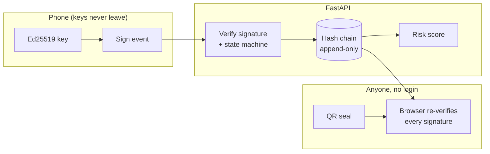

- **One event format.** Every action (payment, seller confirmation, seal, checkpoint, customs decision) is the same
  envelope: `{shipment, seq, type, payload, GPS, time, nonce, prev_hash, signer}`. The same envelope will come from a
  hardware seal later.
- **Canonical JSON (RFC 8785).** Floats are forbidden. Money is integer fen and paisa; GPS is integer microdegrees. The
  hash is SHA-256 and the signature is Ed25519 over the hash. The Python and TypeScript implementations are tested
  against the same shared vectors in [`docs/test_vectors.json`](docs/test_vectors.json).
- **Per-line hashes.** The manifest hash is built from hashes of each line, so tampering is located to the exact line.
- **Keys stay on the device.** The server stores only public keys, and can revoke one without invalidating history.
- **The server counter-signs the time** it received each event, so a back-dated signature is visible as a gap.
- **The QR works offline.** It carries `{shipment, manifest hash, public key, signature}`. A phone checks the signature
  locally first, then compares with the server.

### Risk score, in plain sentences

Officers see reasons, not a black box.

| Signal | Weight |
|---|---|
| Integrity broken | +60 |
| Paid amount differs from manifest by more than 2% | +25 |
| Price outside the usual band for that HS code | +15 per line (max 30) |
| Checkpoint outside its geofence | +15 |
| New trader (fewer than 3 clean shipments) | +10 |
| Trust score above 80 | −15 |

Bands: **green** below 30 &nbsp;·&nbsp; **amber** 30&ndash;59 &nbsp;·&nbsp; **red** 60 and above.

---

## 🧱 What is in the box

<details>
<summary><b>Features</b></summary>
<br>

- **Receipt reader.** Photo in; lines, Urdu/English names and HS codes out. Totals are re-checked in code, not trusted
  from the AI. Printed-total versus line-sum mismatches are flagged. Runs through the local `claude` CLI, with
  PaddleOCR as an optional alternative.
- **WeBOC-style manifest** with per-line hashes and an indicative duty and sales-tax estimate (labelled, at a fixed
  sandbox rate).
- **Sandbox ledger.** Double-entry, integer minor units, every transaction balanced.
- **Trust score and credit limit.** `max(0, (score − 60) × Rs 2,000)`, capped at Rs 100,000, with the reasons shown.
- **Seller page without an account.** A link, a Mandarin screen, a key created on the seller's phone.
- **Offline checkpoint queue.** Stored in IndexedDB; on reconnect it re-fetches the chain head and re-signs, keeping
  the original time, GPS and nonce.
- **Public verify page** with in-browser QR scanning.
- **Admin console.** Tamper lab, users and keys (with revoke), append-only audit log.
- **Security basics.** Rate limits, upload re-encoding that strips EXIF, security headers, refresh-token rotation with
  reuse detection, CNIC stored only as a hash.

</details>

<details>
<summary><b>Tech stack</b></summary>
<br>

| Layer | Choice |
|---|---|
| API | FastAPI, Pydantic v2, SQLAlchemy 2, SQLite (Postgres/Supabase next) |
| Web | React 19, Vite 6, Tailwind 4, PWA, i18next (Urdu RTL / English / Chinese) |
| Crypto | Ed25519, SHA-256, RFC 8785 canonical JSON, `@noble/ed25519` and `PyNaCl` |
| Scan and QR | `jsQR` (camera), `qrcode` |
| Tooling | `uv`, `pnpm`, `pytest`, `vitest` |

</details>

<details>
<summary><b>Project layout</b></summary>
<br>

```
backend/app/
  core/        config, canonical JSON, crypto, DB models + append-only triggers, auth deps
  integrity/   event envelope, hash chain, manifest, public verify report
  ocr/ shipments/ transit/ seller/ customs/ ledger/ risk/ trust/ admin/ auth/ keys/
frontend/src/
  trader/      /t   phone app: scan, review, pay, seal, track, wallet, duty
  seller/      /s   no-login seller confirmation
  customs/     /c   customs console
  verify/      /v   public verification
  admin/       /admin  tamper lab, users, audit
  shared/      API client, crypto, i18n
docs/          PLAN.md (why), CONTRACTS.md (API), research/FACTS.md (sourced facts)
demo/          sample receipts, DEMO_SCRIPT.md
```

</details>

---

## 🚀 Run it in two minutes

**You need:** Python 3.13 with [`uv`](https://docs.astral.sh/uv/), Node 20+ with `pnpm`, and the
[`claude` CLI](https://docs.claude.com/en/docs/claude-code) signed in (receipt reading uses it; there is no API key to
manage).

```powershell
git clone https://github.com/Asharib19khan/sost-smart-corridor.git
cd sost-smart-corridor
cd frontend; pnpm install; cd ..
cd backend;  uv sync;      cd ..

.\dev.ps1 -Seed        # reset the demo DB, seed users, sellers and wallets, start API :8000 + web :5173

# optional: two real shipments already waiting at Sost for the customs officer
cd backend; uv run python scripts/seed_demo.py
```

Open **http://localhost:5173**.

| Who | Phone | PIN | Opens |
|---|---|---|---|
| Karim (trader) | `+923001110001` | `1111` | `/t` |
| Nasreen (trader) | `+923001110002` | `2222` | `/t` |
| Sher Ali (driver) | `+923001110003` | `3333` | `/t` |
| Officer Ayesha (customs) | `+923001110004` | `4444` | `/c` |
| Corridor Admin | `+923001110005` | `5555` | `/admin` |
| Seller shops | no login | link | `/s/kashgar-bazaar-01` &hellip; `03` |
| Anyone | no login | QR | `/v` |

Sample receipts to upload are in [`demo/receipts/`](demo/receipts) (`r3.png` is a good first one).
These accounts are demo data only.

### Show it on phones

`dev.ps1` prints a second address, like `http://192.168.x.x:5173`. Phones on the same Wi-Fi can open it, and the seal QR
codes are printed with that address so a visitor's own phone camera opens the verify page straight from the QR.

Two honest limits of plain `http` on a phone: browsers only allow **GPS and the in-app camera scanner on `https` or
`localhost`**. So on a phone, tick "demo location" for checkpoints (it is labelled), and scan seals with the phone's
normal camera app rather than the in-page scanner. Some venue Wi-Fi blocks device-to-device traffic; a phone hotspot
from your own phone is the reliable fallback.

### Use Supabase instead of the local database

By default the app uses a local SQLite file. To use Postgres (for example Supabase), put the **session pooler** string in
`backend/.env` (it is gitignored, never commit it):

```
SOST_DATABASE_URL=postgresql+psycopg://postgres.<project-ref>:<password>@aws-0-<region>.pooler.supabase.com:5432/postgres
```

On first start the app creates the tables, installs the append-only audit trigger, and turns on row-level security with
no policies, so Supabase's public API key can read nothing. The same end-to-end test runs against it:
`SOST_E2E_DATABASE_URL=<that url> uv run pytest tests/test_e2e.py`. Over the internet each action is about a second
slower than local SQLite. Use the *session pooler*, not the direct host (direct is IPv6-only).

To wipe Supabase back to fresh demo data (deletes everything in it): `.\dev.ps1 -Seed`, or
`cd backend; uv run python scripts/reset_db.py --yes`. Without `--yes` it only prints which database it would wipe.

### Before a real deployment

- `SOST_DEMO_MODE=false` turns off the Tamper lab (raw database edits) and the demo-account list on sign-in.
- The login-token secret is generated on first start into `backend/data/jwt_secret` (git-ignored). On a server,
  set `SOST_JWT_SECRET` (32+ random characters) instead; a short or default value is refused.

### Check it

```powershell
cd backend;  uv run pytest -q                                   # 10 tests, including the full judge story + attacks
cd frontend; pnpm exec tsc --noEmit -p tsconfig.app.json; pnpm exec vitest run; pnpm build           # 11 tests, incl. QR round-trip
```

---

## 🧭 Honest limits

This is a hackathon prototype, and the screens say so wherever it matters.

- **Sandbox money.** Wallets, payments and duty use demo balances, not real yuan or rupees. The FX rate is fixed and
  labelled.
- **Dev OTP.** SMS is not connected, so the sign-up code is shown on screen, and labelled as such.
- **Demo location.** The track screen has an opt-in "demo location" tick for presentations. It is labelled, and the
  default is the phone's real GPS.
- **Duty is indicative.** Rates are from a small seeded table, not the live tariff.
- **Tested in a browser, not on hardware:** the offline checkpoint queue (browser set offline, then reconnected) and QR decoding (round-trip test). Camera scanning on a physical phone has not been tried.
- **Single machine.** SQLite and one API process. Moving to Postgres/Supabase is planned, not done.

## 🗺️ Where it goes next

- [ ] Hardware e-seal emitting the same signed event
- [ ] Postgres / Supabase and a hosted deployment
- [ ] Export a manifest in a customs-system-friendly format
- [ ] Live tariff and a real CNY/PKR settlement rail
- [ ] A pilot desk at Sost for one season

---

<div align="center">

<sub>Built for the Technology Showcase. Demo data and invented shops throughout.</sub>

</div>
